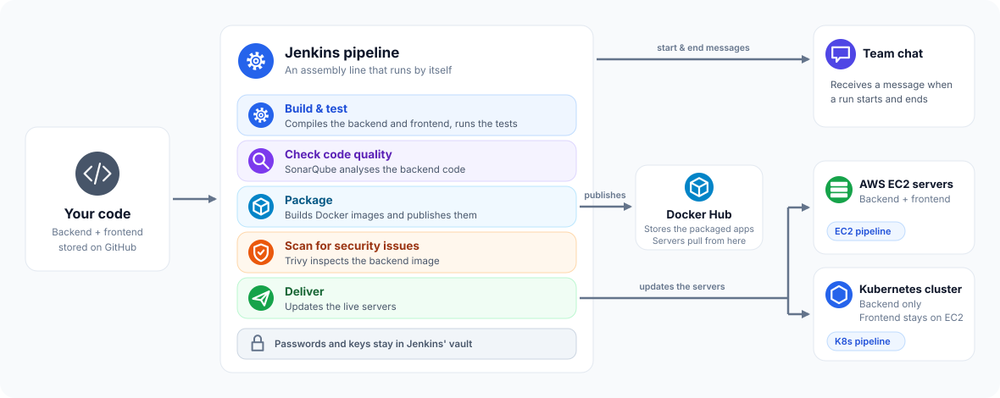
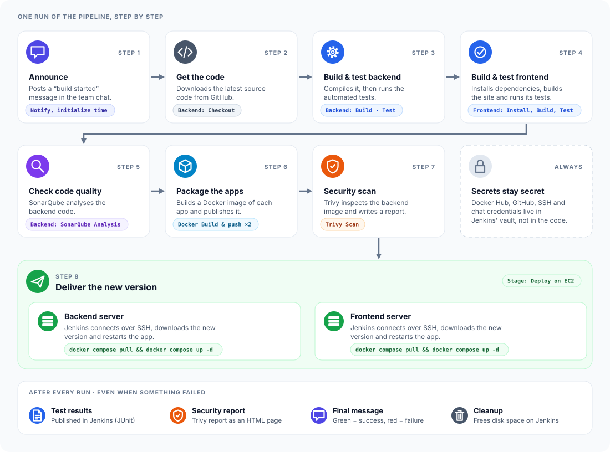
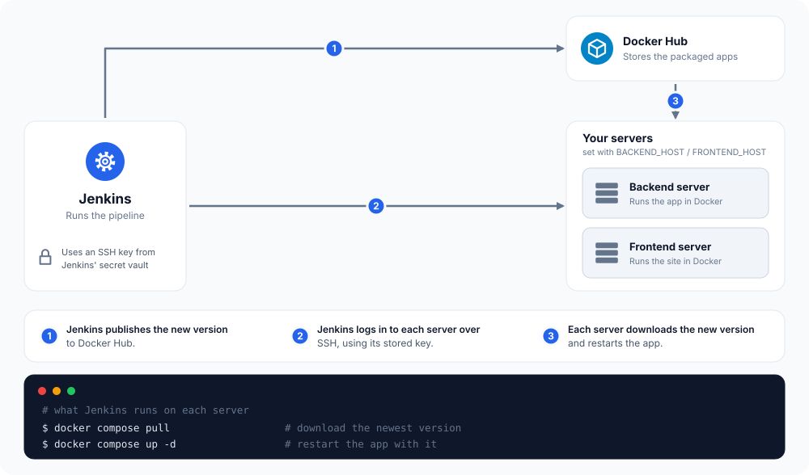
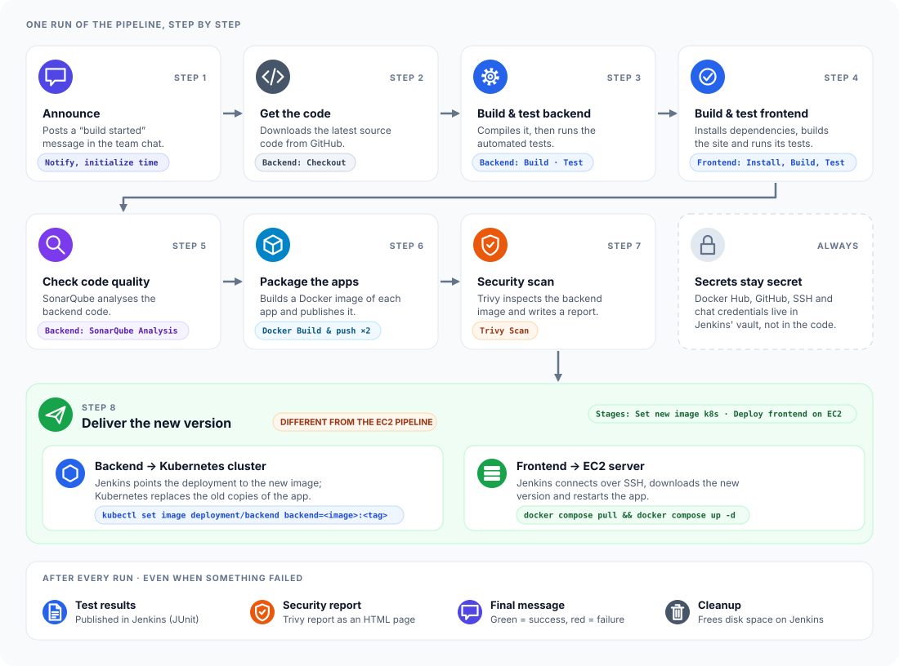
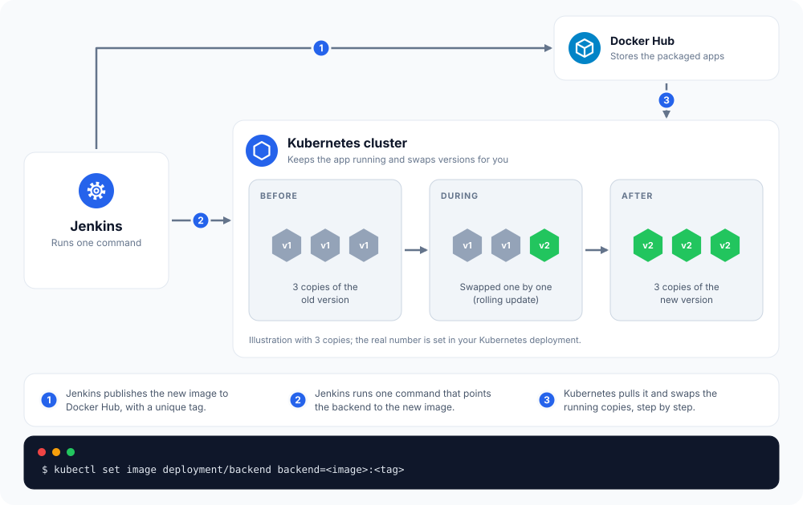
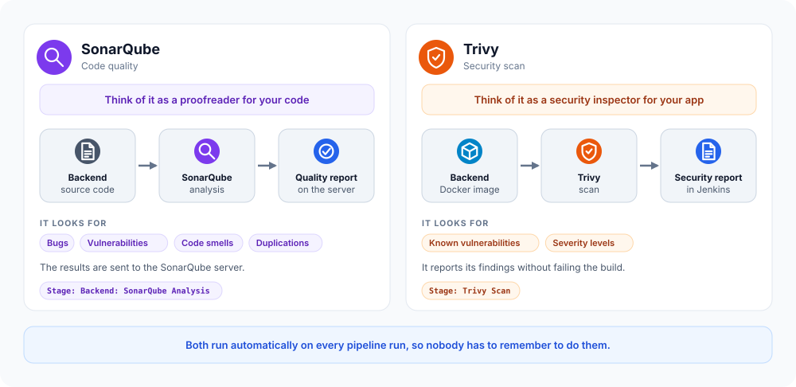

# Jenkins
_CI/CD pipelines for a Java + Node.js application, delivered on AWS EC2 or Kubernetes_

Jenkins DevSecOps pipelines that take an application from source code to a running service: **build and test**, **quality and security** checks, Docker images **packaging**, servers **delivery** . Everything runs automatically, from a single Jenkinsfile.

Originally written during my junior DevOps internship, then made generic so it can be reused on any project.

## Overview

| Pipeline | Delivers the backend to | Delivers the frontend to |
| :-- | :-- | :-- |
| [EC2 pipeline](pipelines/ec2_pipeline/Jenkinsfile) | An EC2 server | An EC2 server |
| [K8s pipeline](pipelines/k8s_pipeline/Jenkinsfile) | A Kubernetes cluster | An EC2 server |

---

## EC2 pipeline

The complete pipeline: it builds, tests, checks, packages and delivers the application to EC2 servers.

| # | Step | What it does | Stage name in the Jenkinsfile |
| :-- | :-- | :-- | :-- |
| 1 | Get the code | Clones the application repository over SSH | `Backend: Checkout` |
| 2 | Build & test backend | `mvn clean package`, then `mvn test` with the `ci` Spring profile | `Backend: Build`, `Backend: Test` |
| 3 | Build & test frontend | `npm ci`, `npm run build`, `npm run test` | `Frontend: Install`, `Build`, `Test` |
| 4 | Check code quality | SonarQube analysis of the backend | `Backend: SonarQube Analysis` |
| 5 | Package the apps | Builds both Docker images and pushes them to Docker Hub, tagged with the build number and `latest` | `Docker Build & push backend`, `Docker: Build & push frontend` |
| 6 | Security scan | Trivy scan of the backend image, written to an HTML report | `Trivy Scan` |
| 7 | Deliver | Updates the backend and frontend servers | `Deploy on EC2` |

### Delivery to EC2

Jenkins connects to each server over SSH and runs `docker compose pull && docker compose up -d`: the server downloads the new images from Docker Hub and restarts the application with them. The SSH key is stored in Jenkins' credentials, and the two servers are set with the `BACKEND_HOST` and `FRONTEND_HOST` variables.

---

## Kubernetes pipeline

The same pipeline, except that the **backend runs on a Kubernetes cluster** instead of an EC2 server. Steps 1 to 7 are identical; only the delivery changes.

| | EC2 pipeline | K8s pipeline |
| :-- | :-- | :-- |
| Backend delivery | SSH + `docker compose` on an EC2 server | `kubectl set image` on the cluster |
| Frontend delivery | SSH + `docker compose` on an EC2 server | Unchanged: SSH + `docker compose` on an EC2 server |
| Image tag | Build number | Unique generated tag |
| Stages | `Deploy on EC2` | `Set new image k8s`, `Deploy frontend on EC2` |

### Delivery to Kubernetes

Each run gives the images a **unique tag**, so Kubernetes can tell that a new version exists. Jenkins then runs a single command, `kubectl set image deployment/backend backend=<image>:<tag>`, and Kubernetes takes over: it pulls the new image and replaces the running copies of the backend step by step (a rolling update).

---

## Quality and security

- **SonarQube** analyses the backend code (`mvn sonar:sonar`) and sends the results to the SonarQube server configured in Jenkins.
- **Trivy** scans the backend Docker image for known vulnerabilities and writes an HTML report using a custom template. It runs with `--exit-code 0`: it reports its findings without failing the build.

---

## Setup

### Jenkins configuration

| Item | Used for |
| :-- | :-- |
| Tools `M3` and `N20` | Maven 3 and Node.js 20 (Manage Jenkins → Tools) |
| SonarQube server named `sonarqube` | `withSonarQubeEnv` (Manage Jenkins → System) |
| Plugins | Pipeline, Git, Credentials Binding, Docker Pipeline, SSH Agent, NodeJS, SonarQube Scanner, JUnit, HTML Publisher |

On the Jenkins agent: Docker, the [Trivy](https://github.com/aquasecurity/trivy) binary and its HTML template (`/var/jenkins_home/trivy` and `/var/jenkins_home/html.tpl`), and, for the K8s pipeline, `kubectl` configured to reach your cluster.

### Credentials

| ID | Type | Used for |
| :-- | :-- | :-- |
| `jenkins-ssh-key` | SSH private key | Cloning the application repository from GitHub |
| `docker-hub-creds` | Username and password | Pushing the Docker images |
| `aws-key` | SSH private key | Logging in to the servers to deliver the new version |
| `discord-webhook` | Secret text | Posting the chat messages |

### Variables

Set these in the `environment` block of the Jenkinsfile.

| Variable | Purpose |
| :-- | :-- |
| `GITHUB_REPO_SSH`, `GITHUB_BRANCH` | Application repository and branch to build |
| `DOCKER_REGISTRY` | Docker registry URL |
| `DOCKER_BACKEND_IMAGE`, `DOCKER_FRONTEND_IMAGE` | Names of the Docker images (`user/backend`, `user/frontend`) |
| `SPRING_DATASOURCE_URL`, `SPRING_PROFILES_ACTIVE` | Database and Spring profile used by the backend tests |
| `BACKEND_HOST`, `FRONTEND_HOST` | Servers to deliver to (EC2 pipeline). The K8s pipeline only uses `FRONTEND_HOST` |

Then create a **Pipeline** job in Jenkins and point it to the Jenkinsfile of the pipeline you want to use.

## Works well with

The servers these pipelines deliver to can be prepared with my [Ansible playbooks](https://github.com/NullBrunk/Ansible): common admin user, SSH access, stable internal host names and Docker.

## Skills demonstrated

- **CI/CD**: declarative Jenkins pipelines, multi-stage builds, credentials management
- **Containers**: Docker image build and publishing, Docker Compose delivery
- **Kubernetes**: rolling updates with `kubectl`
- **DevSecOps**: static analysis with SonarQube, image scanning with Trivy
- **Observability**: chat notifications, test and security reports
- **AWS**: EC2 delivery over SSH
